<div align="center">

  <!-- Interactive Terminal HUD Header with Cyber Light Sweep & Node Telemetry -->
  

  <br/><br/>

  <!-- System Architecture & Live Data Flow Animation -->
  

</div>

<br/>

---

### About

I am a Python developer and postgraduate student currently pursuing my **M.Sc. in Data Science at Marwadi University**, having previously completed my **Bachelor of Computer Applications (BCA)** at Sahajanand College of IT & Management, Gondal (2023–2026).

My technical work focuses on building clean, structured web services and data-centric backend platforms. With **Python, Django, Flask**, and relational database engines like **PostgreSQL** and **MySQL**, I design schema architectures, secure RESTful APIs, and transaction-safe workflows. In parallel, my academic training in data science centers on statistical analysis, data cleaning pipelines, and predictive algorithms using **NumPy, Pandas, and Scikit-Learn**.

I prioritize writing code that is clean, readable, and predictable. Rather than adding unnecessary abstraction, I focus on understanding data flows, optimizing database interactions, and developing dependable software that addresses real business and administrative requirements.

<br/>

---

### Core Competencies & Technical Pillars

<div align="center">
  <!-- Dynamic 4-Pillar Competencies Dashboard -->
  
</div>

<br/>

#### Backend & Architecture
Python, Django, Django REST Framework, Flask, RESTful API Engineering, Role-Based Access Control

#### Relational Databases & Storage
PostgreSQL, MySQL, Relational Schema Modeling, Query Optimization, Transactional Integrity (ACID)

#### Data Science Fundamentals
NumPy, Pandas, Scikit-Learn, Exploratory Data Analysis, Data Wrangling, Statistical Feature Engineering

#### Tooling & Environment
Git, GitHub, VS Code, Postman, Linux / Bash, Jupyter Notebook

<br/>

---

### Active Engineering Projects

<table>
  <thead>
    <tr>
      <th width="35%">Project</th>
      <th width="45%">Architecture &amp; System Highlights</th>
      <th width="20%">Tech Stack &amp; Source</th>
    </tr>
  </thead>
  <tbody>
    <!-- 1. Tour Management System -->
    <tr>
      <td>
        <b>Tour Management System</b><br/>
        <sub>Full-Stack Tour Booking &amp; Reservation Platform</sub>
      </td>
      <td>
        Built a centralized reservation engine handling customer bookings, trip schedules, and dispatch operations. Utilizes Django REST Framework endpoints for decoupled client integration, secure authentication, and relational schema migrations in PostgreSQL.
      </td>
      <td>
        Django<br/>
        Django REST Framework<br/>
        PostgreSQL<br/><br/>
        <a href="https://github.com/bhavikmv/Tour-Management-System">
          
        </a>
      </td>
    </tr>
    <!-- 2. Phonora -->
    <tr>
      <td>
        <b>Phonora</b><br/>
        <sub>Online Mobile Shop &amp; Inventory Management</sub>
      </td>
      <td>
        Engineered an e-commerce platform paired with an automated inventory tracking back-office for mobile consumer electronics. Includes relational order-inventory synchronization, real-time low-stock alerts, customer shopping carts, and dynamic invoice printing.
      </td>
      <td>
        PHP<br/>
        MySQL<br/>
        JavaScript<br/><br/>
        <a href="https://github.com/bhavikmv/Phonora-Mobile-Shop">
          
        </a>
      </td>
    </tr>
    <!-- 3. Gadget Management System -->
    <tr>
      <td>
        <b>Gadget Management System</b><br/>
        <sub>Collegiate Requisition &amp; Hardware Approval Portal</sub>
      </td>
      <td>
        A digital requisition portal designed to replace manual paperwork in collegiate hardware distribution. Features a three-stage authorization workflow (student request, faculty verification, inventory release) with return tracking and audit logs.
      </td>
      <td>
        Python / Django<br/>
        MySQL<br/>
        HTML / CSS / JS<br/><br/>
        <a href="https://github.com/bhavikmv/Gadget-Management-System">
          
        </a>
      </td>
    </tr>
  </tbody>
</table>

<br/>

---

### Academic Background

- **Master of Science (M.Sc.) in Data Science**
  *Marwadi University* | Currently Enrolled
  Advanced coursework covering statistical inference, data architecture, machine learning foundations, and scalable data processing.

- **Bachelor of Computer Applications (BCA)**
  *Sahajanand College of IT & Management, Gondal* | 2023 – 2026
  Rigorous training in software engineering methodologies, database management systems (DBMS), data structures, and computer programming.

<br/>

---

### GitHub Activity & Consistency

<div align="center">
  <!-- Consistent GitHub Streak Stats -->
  <a href="https://github.com/bhavikmv">
    
  </a>
</div>

<br/>

---

### Contribution Snake

<div align="center">
  <!-- Contribution Snake Grid (Automated via .github/workflows/snake.yml) -->
  <picture>
    <source media="(prefers-color-scheme: dark)" srcset="https://raw.githubusercontent.com/bhavikmv/bhavikmv/output/github-contribution-grid-snake-dark.svg">
    <source media="(prefers-color-scheme: light)" srcset="https://raw.githubusercontent.com/bhavikmv/bhavikmv/output/github-contribution-grid-snake.svg">
    
  </picture>
  <br/>
  <sub>Generated automatically via GitHub Actions on the <code>output</code> branch</sub>
</div>

<br/>

---

### Communication & Connection Console

```bash
# Terminal Connection Interface
$ ssh -v connect@bhavik.dev --channels="email,linkedin,github,portfolio"
```

<div align="center">
  <!-- Interactive 4-Channel SVG Communication Station -->
  
</div>

<br/>

<div align="center">
  <table border="0" cellpadding="8" cellspacing="0">
    <tr>
      <td align="center">
        <a href="mailto:bhavikmv5@gmail.com">
          
        </a>
      </td>
      <td align="center">
        <a href="https://linkedin.com/in/YOUR_LINKEDIN_USERNAME" target="_blank">
          
        </a>
      </td>
      <td align="center">
        <a href="https://github.com/bhavikmv" target="_blank">
          
        </a>
      </td>
      <td align="center">
        <a href="https://YOUR_PORTFOLIO_URL" target="_blank">
          
        </a>
      </td>
    </tr>
  </table>
</div>

<br/>

<div align="center">
  <sub>Bhavik Vasavada · Python Developer &amp; Postgraduate Data Science Scholar · Marwadi University</sub>
</div>
